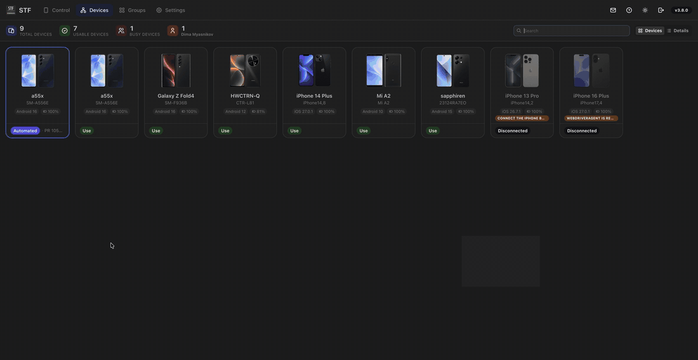
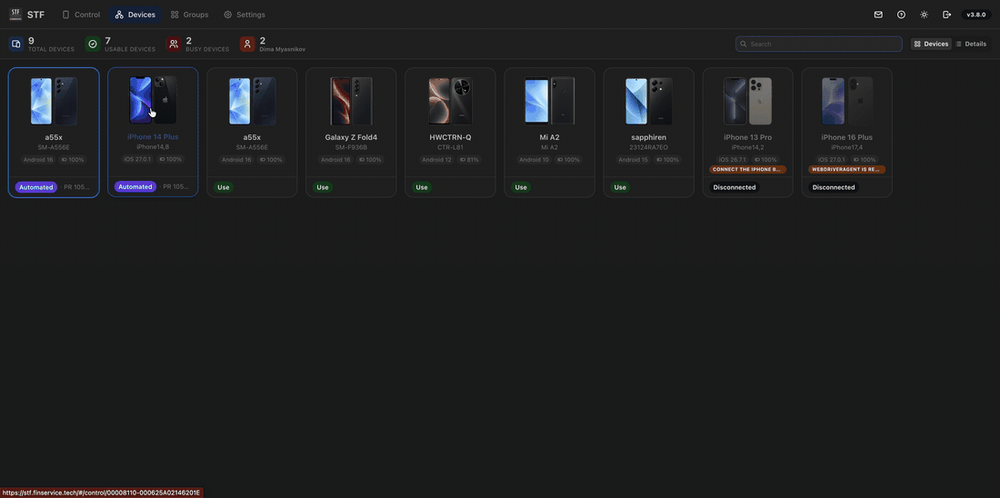

# Automation viewer demonstration

Recorded from the Linux/Kubernetes hardware test deployment on 2026-10-24,
using a Galaxy A55 (Android 16) and an iPhone 14 Plus (iOS 27.0.1).
The operator navigated STF manually with the interface set to English.

For each clip, a separate automation account reserved the phone while Appium
scrolled Settings. The operator opened the read-only view and reloaded it, then
waited for the test session and reservation to end. Pressing **Use** enabled
manual control without another page reload; **Home** and **Stop Using** completed
the demonstration.

These are real interface captures. Waiting between steps was trimmed; actions
retain their recorded speed. Device identifiers are masked. GIFs are 1100 px wide
at 10 fps, without audio. Browser tabs, address bar and bookmarks are outside the
captured area.

## Android

## iPhone

See the [automation viewer guide](../automation-viewer.md) to reproduce the
reservation and observation workflow.
