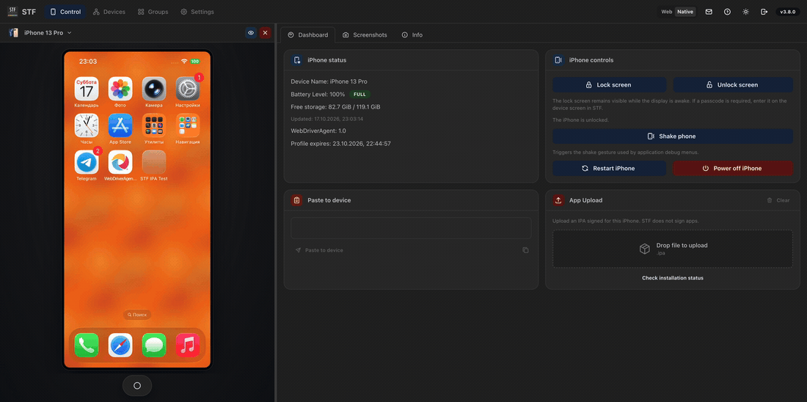
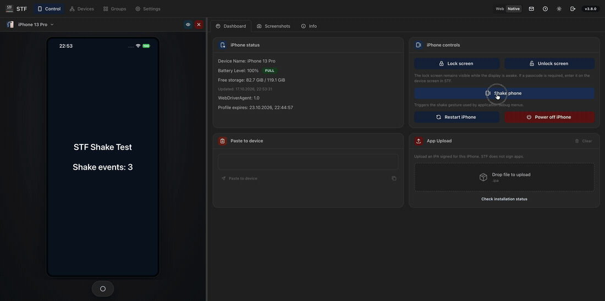
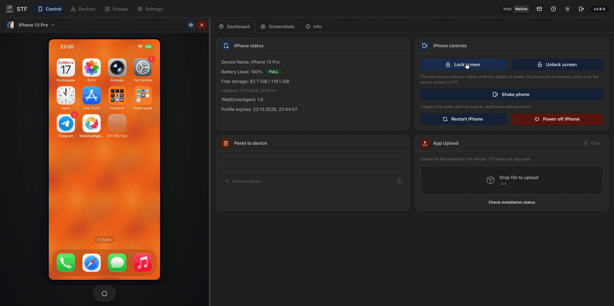
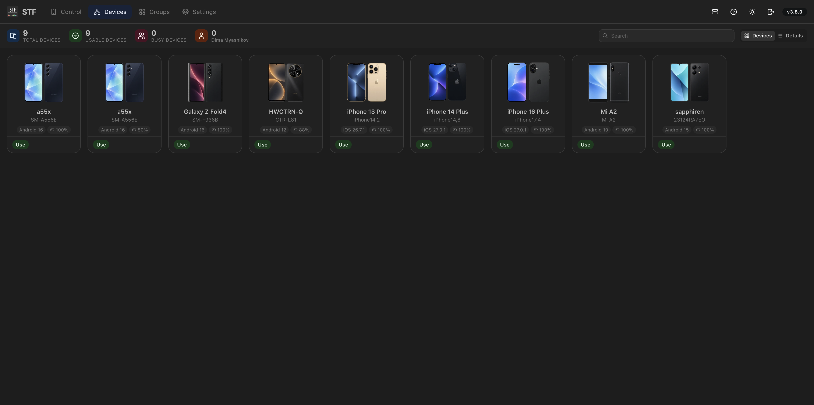
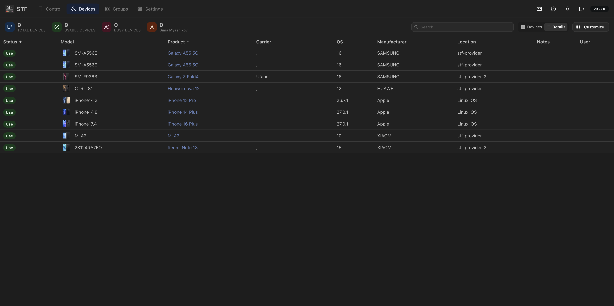
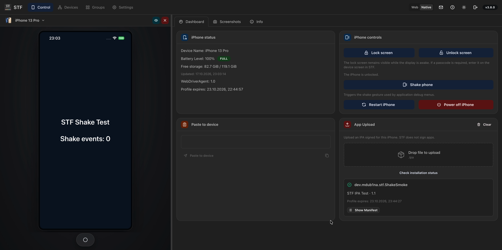

# Linux iOS demonstration

Captured on 2026-10-17 from the Kubernetes hardware trial deployment of the
implementation, using iPhone 13 Pro / iOS 26.7.1 on a Linux USB worker. The Mac
captured the web interface; it was not the iOS runtime node. Browser actions were
performed manually, with STF's interface set to English.

The clips retain recorded speed; only leading/trailing waits were trimmed.
MP4 copies are 1920 px wide at 24 fps; GIF copies are 1100 px wide at 6 fps.
There is no audio. Browser tabs, address bar and bookmarks are outside the
captured area. These are real interface captures, not rendered mockups.

## Signed IPA installation

A signed test IPA is dropped into App Upload, installs on the selected phone
and opens. The success card identifies the installed test app and its profile
expiry. The recording replaces an existing copy of that same test application;
STF does not sign or re-sign it. The signed IPA itself is not distributed here.

[MP4 video](iphone-ipa-install.mp4)

## Shake

The operator opens the UIKit test app and presses Shake phone. The system
AssistiveTouch action increases its motion-event counter from **3 to 4**.

[MP4 video](iphone-shake.mp4)

## Lock and unlock

Lock screen locks the phone and turns its display off; Unlock screen wakes and
unlocks it. The black frames in this clip are the sleeping physical display.
No passcode is entered in the recording.

[MP4 video](iphone-lock-unlock.mp4)

## Screenshots

The inventory includes three iPhones alongside Android devices, with paired
front/rear artwork and corresponding miniature icons in the table.

The iPhone dashboard shows health/signing information, device controls and
successful IPA installation, alongside the live test app.

See the [provider guide](../ios-provider.md),
[three-phone hardware record](../ios-fleet-validation-2026-10-16.md) and
[local Compose/native validation](../ios-local-validation-2026-10-17.md) for
the implementation, test coverage and remaining limitations.
