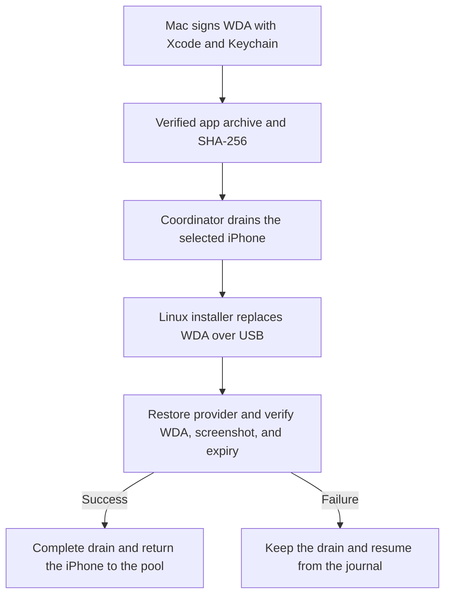

# Personal Team WDA renewal

Run `renew.py` on demand to sign WebDriverAgent (WDA) on a Mac and replace it
on an idle iPhone in a Linux Kubernetes deployment. It keeps the same runner
bundle ID and signing identity.
Signing keys stay in the Mac Keychain. Linux receives only a verified signed
application. The command makes one pass and exits; it installs no background
service, monitoring process or schedule.

Apple's [Personal Team rules](https://developer.apple.com/help/account/basics/about-your-developer-account)
give provisioning profiles a seven-day lifetime. Renewing requires rebuilding
and reinstalling the application; replacing a profile file alone is insufficient.
Xcode account authentication, two-factor authentication, agreements, a locked
Keychain or device trust may still require a person. A failed attempt remains
visible in the private status file and never becomes a successful renewal.

## Quickstart

You need a Mac with Python 3, Git, `kubectl`, Xcode and the existing signing
account and Keychain. The iPhone must already have trusted, signed WDA.
Use a single-device Kubernetes Deployment with the
[STF Helm iOS layout](../../kubernetes/helm/templates/ios.yaml) or its
environment-configured equivalent. Pin the Linux iOS runtime image by digest.
The runtime needs the node's usbmuxd socket, and Appium Grid needs a relay slot
for the same iPhone. Standalone Docker and native providers use their own
[installation procedure](../../doc/ios-provider.md#manual-launch-against-an-existing-stf-deployment).

1. Deploy the [coordinator](../../doc/coordinator.md#recovery-and-maintenance)
   and matching fenced providers. Keep the coordinator's state/PVC. Route
   Appium sessions for the device through the coordinator. Pause any autoscaling
   or reconciliation that can restore the selected Deployment's replicas during
   the operation. The kubeconfig needs access to inspect the selected workloads,
   pods and ConfigMaps, execute in the coordinator and iOS runtime, scale the
   selected iOS Deployment, and create, inspect and delete the installer pod.
2. Prepare the private pinned WDA checkout and signer configuration from
   [SIGNER.md](SIGNER.md), then the worker and renewal configuration below.
   Keep the previous accepted profile as the signing baseline. Start with one
   available phone and review its namespace, Deployment and bundle ID.
3. From the STF checkout, run one renewal pass:

```sh
python3 tools/wda-renewal/renew.py --config /secure/wda/config/renew.json
```

Read the last result without connecting to the farm:

```sh
python3 tools/wda-renewal/renew.py --config /secure/wda/config/renew.json --status
```

`--status` requires an existing saved result. It does not check the current
phone or trigger a renewal. The command returns zero when every target was
renewed or confirmed `notDue`; failed, offline or manually occupied targets
produce a nonzero result. The Mac is needed only while the command runs.

## Lifecycle



1. Each invocation of `renew.py` checks the configured devices once. Profiles
   with more than 48 hours left need no build or device restart. Offline or
   manually occupied phones are reported; interrupted operations resume using
   their existing journal and artifact.
2. `sign.py` builds pinned WDA `e7e2665a00633dc174d7fc579f7e606bc9ba782a`
   with the existing Xcode account. It verifies the exact bundle, Personal Team,
   device membership, expiry improvement and signatures, including nested code.
   An exact local profile-cache refresh is permitted only with backup/restore.
   See [SIGNER.md](SIGNER.md). Certificates and portal profiles are not revoked.
3. `worker.py` creates a durable operator-only coordinator drain for one serial.
   New allocations stop immediately; existing tests finish normally. A manual
   owner is never interrupted. Drain records have no automatic timeout that
   could reopen a phone after an uncertain installation.
4. Before stopping the phone pod, the worker confirms the selected Deployment,
   ConfigMap values, pod ownership, image, zero target Grid sessions and its own
   fenced STF ownership. It preserves a private snapshot and recovery journal.
5. A short-lived non-root installer pod mounts only the selected node's usbmuxd
   socket and temporary directories. It has no Kubernetes token, signing key,
   STF token or coordinator credential. The archive hash, paths, profile and
   device are checked again before `ios install` replaces WDA.
6. The original phone Deployment resumes. The worker requires a ready WDA and
   a real PNG before retiring any superseded exact-bundle profile UUIDs. Other
   apps, wildcard profiles, certificates and pairing state are preserved. A
   second controlled restart refreshes profile telemetry when necessary.
7. The worker confirms the new unambiguous expiry, readiness, screenshot, empty
   target Grid and cleared ownership before completing the coordinator drain.
   The accepted embedded profile becomes the next signing baseline.

Deployment changes during an operation, foreign ownership, unknown sessions,
unknown signing metadata or invalid artifacts stop the operation. The recovery
journal preserves the operation and artifact identity. The worker restores the
original replica count when safe and keeps the coordinator drain on failure.
Expired-profile recovery additionally requires fresh selected-device USB proof;
it does not treat an offline phone or a missing profile as permission to install.

## Coordinator contract

The operator credential can use:

| Method | Route | Meaning |
| --- | --- | --- |
| POST | `/api/v1/maintenance` | `{serial, operationId}`; idempotent drain, UUID operation ID |
| GET | `/api/v1/maintenance/:id` | `draining` while any nonterminal lease remains, otherwise `ready` |
| DELETE | `/api/v1/maintenance/:id` | Complete only after fresh free-device, signing and Grid checks |

Project CI credentials receive 403 for these operations. This API does not
install WDA or mutate STF ownership. The Mac worker reads credentials only
inside the existing coordinator pod and sends no credential to the installer.

iOS allocation requires a canonical, unambiguous profile check no older than
one hour. Its expiry must exceed the requested maximum test duration by five
minutes. A heartbeat cannot extend a test through profile expiry. Android
allocation is unchanged. Completing a drain requires signing that covers the
coordinator's full configured duration limit and an UP relay for that phone.

## Private configuration

Keep configuration, source cache, profiles, artifacts, logs and journals outside
Git. Use directories `0700` and JSON/profile/archive files `0600`. Account IDs,
device IDs, kubeconfig contents and profile data are operator configuration.
`sign.py` documents its configuration in [SIGNER.md](SIGNER.md).

Worker configuration:

```json
{
  "version": 1,
  "kubeconfig": "/secure/farm-kubeconfig",
  "stateDirectory": "/secure/wda/worker",
  "coordinatorNamespace": "stf",
  "coordinatorDeployment": "stf-coordinator",
  "stfApiUrl": "http://stf-api.stf.svc.cluster.local:3000/api/v1",
  "gridUrl": "http://selenium-router.appium.svc.cluster.local:4444",
  "minValidityHours": 48,
  "drainTimeoutSeconds": 7200,
  "allowExpiredWdaRecovery": false,
  "devices": [{
    "serial": "YOUR_DEVICE_UDID",
    "namespace": "YOUR_IOS_NAMESPACE",
    "deployment": "YOUR_PHONE_DEPLOYMENT",
    "bundleId": "YOUR_INSTALLED_WDA_RUNNER.xctrunner"
  }]
}
```

Set `stfApiUrl` and `gridUrl` to the same URLs the coordinator uses.

`allowExpiredWdaRecovery` is an explicit opt-in for a connected phone whose
known WDA profile has already expired. It still requires the worker's fresh USB
profile proof, matching Deployment, no foreign owner and no Grid session. Leave
it disabled until this recovery path is verified for the selected provider.

Renewal command configuration:

```json
{
  "version": 1,
  "stateDirectory": "/secure/wda/renewal",
  "signerConfigPath": "/secure/wda/config/signer.json",
  "workerConfigPath": "/secure/wda/config/worker.json",
  "renewBeforeHours": 48
}
```

Keep Apple credentials in the Mac account/Keychain; do not copy them into a
Kubernetes Secret or farm CI job. Run the command again when renewal is needed.
No LaunchAgent, `caffeinate`, periodic loop or global power setting is installed.

Keep the existing `stateDirectory` when upgrading an earlier installation. The
internal `service-state.json` filename is retained for baseline and interrupted
operation compatibility; it is a private state file, not a running service.

On a failure inspect the private status and attempt logs. Do not clear a drain
merely to make a failed job green. Re-running the worker uses the same journal;
do not replace its pending artifact with a different build. Re-run the same
command after resolving the reported cause to resume the pending operation.

## Verification

```sh
python3 -m unittest discover -s tools/wda-renewal -p 'test_*.py'
npm run test:unit
```

The Python tests use fake devices, processes and Kubernetes clients. They cover
signature/profile constraints, unsafe archives, cache rollback, durable recovery,
foreign ownership, busy Grid, exact-profile retirement and one-shot execution.
A real signing build, installation, fresh telemetry and Appium CI smoke must be
recorded separately; fixture tests cannot prove Apple authentication or USB
availability.

For a hardware check, renew one available iPhone and confirm the fresh expiry
in Devices, a working screenshot and a new Appium session through the
coordinator.
